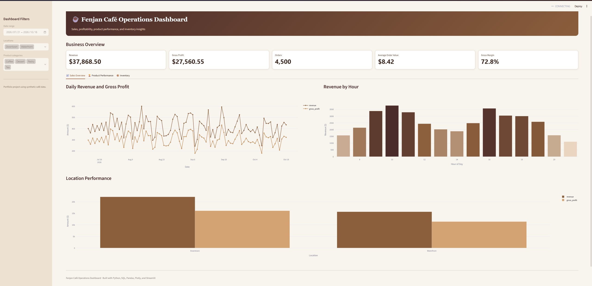
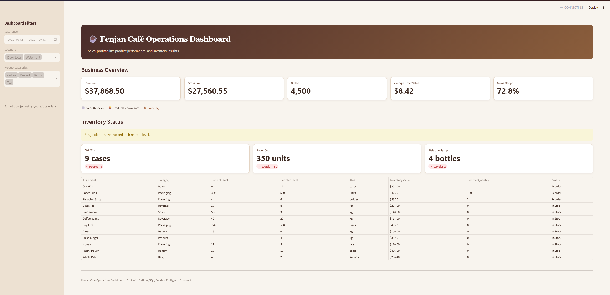

# Fenjan Café Operations Dashboard

An interactive business intelligence dashboard for monitoring café sales, profitability, product performance, location performance, and inventory levels.

The project uses synthetic café data and demonstrates a complete analytics workflow using Python, SQL, Pandas, Plotly, Streamlit, automated testing, and Git.


> All names, transactions, financial figures, and inventory records in this project are fictional and generated for demonstration purposes.

## Live Demo

[Open the Fenjan Café Operations Dashboard](https://fenjan-cafe-dashboard.streamlit.app)

## Features

- Interactive date, location, and product-category filters
- Revenue, gross profit, order count, average order value, and margin KPIs
- Daily revenue and gross-profit trends
- Hourly sales analysis
- Product performance and category comparisons
- Location performance reporting
- Inventory tracking with automatic reorder alerts
- SQLite analytics database
- Automated analytics tests
- Responsive Streamlit interface

## Dashboard Preview

The dashboard includes three main sections:

1. **Sales Overview**
   - Business KPIs
   - Daily sales trends
   - Revenue by hour
   - Location comparisons

2. **Product Performance**
   - Product revenue rankings
   - Quantity sold
   - Gross profit by product

3. **Inventory**
   - Current stock levels
   - Reorder thresholds
   - Inventory values
   - Low-stock alerts


### Sales Overview



### Inventory Management



## Technology Stack

- Python 3.12
- Streamlit
- Pandas
- Plotly
- SQLite
- Pytest
- Git and GitHub

## Project Structure

```text
fenjan-cafe-dashboard/
├── .streamlit/
│   └── config.toml
├── data/
│   ├── inventory.csv
│   └── sales.csv
├── tests/
│   └── test_analytics.py
├── analytics.py
├── app.py
├── database.py
├── generate_data.py
├── pyproject.toml
├── requirements.txt
└── README.md
```

The generated SQLite database is excluded from Git and rebuilt locally from the CSV files when needed.

## Running the Project Locally

### 1. Clone the repository

```bash
git clone https://github.com/4pi314/fenjan-cafe-dashboard.git
cd fenjan-cafe-dashboard
```

### 2. Create a virtual environment

```bash
python3 -m venv .venv
source .venv/bin/activate
```

On Windows PowerShell:

```powershell
python -m venv .venv
.venv\Scripts\Activate.ps1
```

### 3. Install dependencies

```bash
python -m pip install -r requirements.txt
```

### 4. Create the SQLite database

```bash
python database.py
```

### 5. Start the dashboard

```bash
streamlit run app.py
```

Open `http://localhost:8501` in your browser.

## Running the Tests

```bash
pytest -v
```

The automated test suite validates:

- Database filter options
- KPI calculations
- Location filtering
- Product-category filtering
- Date filtering
- Sales analytics reports
- Inventory status calculations
- Reorder alerts

## Example Business Insights

The synthetic dataset allows users to identify:

- Revenue and gross-profit trends
- The strongest-performing products
- Peak sales hours
- Performance differences between café locations
- Ingredients requiring immediate restocking

## Data Privacy

This repository contains no real customer, employee, transaction, supplier, or business financial information. The included dataset is entirely synthetic and was generated specifically for this portfolio project.

## Author

**Alaa Alahmad**

- GitHub: [4pi314](https://github.com/4pi314)